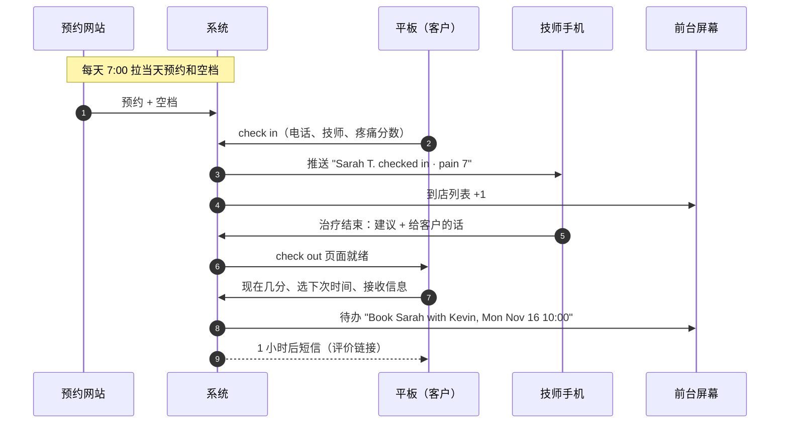

# V-Health Check-in / Check-out 系统 · PRD

| | |
|---|---|
| 客户 | V-Health Rehab Clinic（Calgary NW）：按摩、整骨、针灸 |
| 版本 | v1.0（2026-11-14），根据原型第 4 轮整理 |
| 状态 | 设计已定，待开发 |
| 原型 | https://lego651.github.io/fde/VHealth/deliverables/checkin-checkout-prototype.html#proto（需要 PIN） |
| 负责人 | Jason（FDE，产品）· 诊所老板（决策）· AI 工程师（开发） |

> 本文档里的客户名字、技师名字、分数和日期都是示例。

---

## 0. 一句话

一块前台平板加上技师的手机，接住客户来访的三个时刻：**到店 check in → 治疗结束技师写建议 → 离开 check out**。目的有四个：
1. 用系统替代纸质登记。
2. 让每位客户离开前就约好下一次。
3. 让每位新客户都收到一次请写评价的短信。
4. 让客户觉得"他们记得我"。

---

## 1. 背景和问题

| 现在 | 问题 |
|---|---|
| 前台人工登记，来源写在纸质登记表上 | 来源数据不全，无法统计，也对不上 |
| 技师口头建议"下次什么时候来"，没有记录 | 老板不知道谁讲了、谁没讲；客户走了就没下文 |
| Google 评价约 260 条，主要竞争对手 1,000 多条 | 没有固定的请评价流程 |
| 客户在治疗前后的变化没有记录 | 客户感觉不到变化，第一次来的人没有理由回来 |
| 和预约系统没有打通 | check in 时不知道客户约的是哪位技师 |

技师拿每次收入的约 60%。客户多来一次，技师多赚约 $66，所以技师本来就有动力。缺的是**习惯、开口的那句话和检查**。这个系统解决的是流程和检查，奖金只是补充（见 §12）。

## 2. 目标和指标

| 目标 | 指标 | 目标值（上线 3 个月） | 数据来源 |
|---|---|---|---|
| 新客户来源 100% 有记录 | 有来源的新客户 ÷ 新客户 | ≥ 98% | check in |
| 技师每次都给建议 | 有技师建议的就诊 ÷ 全部就诊 | ≥ 95% | 技师 App |
| 客户离开前约好下次 | check out 时选了时间的比例 | 基线 +15 个百分点 | check out |
| 客户真的回来 | 60 天回头率（真的来了，不是约了） | 基线 +5 个百分点 | check in 记录 |
| 技师真的讲了 | 治疗后短信里回答"讲过"的比例 | ≥ 85% | 短信回复 |
| Google 评价 | 每月新增评价 | ≥ 25 条 | Google Business Profile |

**基线**：上线后的第 1 个月就是基线，团队奖规则在拿到基线以后再宣布。

## 3. 用户和设备

| 用户 | 设备 | 做什么 |
|---|---|---|
| 客户 | 前台平板（iPad，约 $300–500，或用现有的） | check in；check out 时前台把平板转向客户 |
| 技师（约 8–9 人） | 自己的手机，网页 App 添加到主屏幕 | 收到客户到店通知；治疗结束写建议和给客户的话 |
| 前台 | 前台电脑或平板上的"前台屏幕" | 看到谁到了、待约的下次时间、需要分配技师的客户 |
| 老板 | 电脑 | 每周一看看板 |

技师 App 用**网页 App（PWA）**，不上架 App Store。iPhone 从 iOS 16.4 起，添加到主屏幕的网页 App 可以收推送通知。

## 4. 范围

### MVP（本 PRD）
- 平板 check in：2 步，新客户和老客户两种流程
- 每天早上从预约网站拉一次当天预约和各技师的空档
- 技师网页 App：到店通知、写建议
- 平板 check out：现在疼痛几分 → 结果屏（变好 / 持平 / 更高）→ 技师的话 → 选下次时间 → 接收信息
- 前台屏幕：到店列表、待约列表、"需要分配技师"提醒
- 短信：就诊后 1 小时、第 2 天（持平或更高时）、第 3 天技师问候、第 7 天未约提醒
- 老板看板
- English / 中文界面

### 第二阶段
- 分享卡（Instagram 快拍图）
- "你的这一年"年终回顾（12 月）
- 常客（Regular）标记和优先时段
- 第 5、10 次来访的手写卡提醒
- 欢迎礼一屏（**要先得到保险公司确认才能上线**）

### 不做
- 写进或修改预约系统（只读）
- 线上付款
- 按来访次数送礼、按评价数给员工发奖金（违反规则，见 §11）

---

## 5. 核心流程



---

## 6. 功能需求

### 6.1 Check in · 第 1 步（所有人）

**页面**：顶部写 "Step 1 of 2" 加进度条；标题 "Welcome! Just 2 quick steps."；右上角 English / 中文切换。

| # | 需求 | 验收标准 |
|---|---|---|
| CI-1 | **只有一个联系方式框，电话为主。** 默认显示 "Mobile phone"，下面一行小字 "We'll text your appointment reminders here." | 页面上同时只出现一个输入框 |
| CI-2 | 电话框下面一个链接 "No mobile? Use email instead"。点了以后电话框换成 Email 框，链接变成 "Use my mobile instead"；切换时清空另一个框 | 切换来回都正常；提交时只带当前显示的那一个 |
| CI-3 | 没填就点 Next：显示 "Please enter your mobile number."（邮箱模式下是 "Please enter your email."） | — |
| CI-4 | **用电话查当天预约**：输完 10 位号码后，在早上拉到的当天预约里找。找到了就显示卡片 "We found your booking: today 10:00 with Kevin. Not right? Pick your therapist below."，并自动选中 Kevin | 匹配规则：只比较号码里的数字，取最后 10 位；当天同一号码有多个预约时，选时间最近的那一个 |
| CI-5 | 老客户（按电话或邮箱找到）：显示 "Hi Sarah!"。有当天预约就用预约里的技师；没有就默认选上次的技师 | — |
| CI-6 | **"Who's your therapist today?"** 只列**今天上班的**技师（来自早上拉到的排班），用头像（或首字母）加名字，下面写 "here today" | 不上班的技师不出现；同时最多 1 个被选中 |
| CI-7 | **必须选一位技师才能点 Next。** 没有 "Not sure" 选项 | 不选技师，Next 按钮是灰的 |
| CI-8 | 例外：链接 "Can't remember? The front desk will check"。点了以后取消已选的技师，显示 "OK, we've told the front desk. They'll let your therapist know you're here."，Next 可以点；这次 check in 的接收人是**前台** | 前台屏幕出现"需要分配技师：Sarah T."；前台指定技师以后，系统再推送给那位技师 |
| CI-9 | 每次 check in 都有明确的接收人：一位技师，或前台 | 数据库里 `checkins.routed_to` 不能为空 |

**为什么去掉 "Not sure"**：通知必须推到一个明确的人的手机上。早上拉到的预约能自动解决大部分情况；剩下的情况交给前台，不能让通知没人收。

**预约拉取的限制**：每天早上只拉一次，当天早上 7 点以后才约的客户找不到预约，需要自己选技师。如果这种情况多，再改成一天拉几次（见 §13 待确认）。

### 6.2 Check in · 第 2 步

**新客户**：
| # | 需求 |
|---|---|
| CI-10 | 标题 "Nice to meet you"；"Your name"（名和姓，必填） |
| CI-11 | "How did you hear about us?" 8 个选项，必选一个：Google、Friend or family、Poster in a store、Instagram、Facebook、小红书 / WeChat、Walked by、Other |
| CI-12 | 追问只在选中对应选项时出现：Friend → "Who referred you? We'd love to thank them."（选填）；Poster → "Which store?"（Safeway Crowchild、T&T Market、Co-op Dalhousie、Other / not sure）；Other → "Where? (optional)"，例如 newspaper、community event |
| CI-13 | "How much pain are you in right now?" 0–10，11 个按钮，必选；刻度两端写 "0 · none" 和 "10 · worst" |
| CI-14 | 按钮 "Check in"。完成页："You're checked in, Sarah. Please have a seat. Kevin knows you're here." |

**老客户**：
| # | 需求 |
|---|---|
| CI-15 | 标题 "Welcome back, Sarah"，副标题 "Visit 3 with Kevin" |
| CI-16 | 只有疼痛分数一题，下面显示 "Last visit: came in at 5, left at 2." |
| CI-17 | 不再问名字、来源和联系方式 |

**语言**：客户用的界面语言记为他的首选语言，以后短信用这种语言发。不单独问语言。

**用时目标**：新客户约 30 秒，老客户约 10 秒。

### 6.3 技师网页 App

| # | 需求 | 验收标准 |
|---|---|---|
| TA-1 | 登录：每位技师用自己的手机号收验证码登录，登录状态保留 30 天 | — |
| TA-2 | 到店推送："Sarah T. checked in · 9:58 · New client · pain 7 · source: Google" | check in 后 5 秒内收到 |
| TA-3 | "Today" 列表：今天自己的客户，状态为"未到 / 已到 / 已完成" | — |
| TA-4 | 点开一位客户 → 写建议："Your recommendation"（必选）：1 week / 2 weeks / 3–4 weeks / No follow-up | — |
| TA-5 | 选了时间：再选 "About how many visits?"：2–3 / 4 / 6 / 8+ | — |
| TA-6 | 选了 No follow-up：必须选原因：Goal reached / Referred out / Client declined | — |
| TA-7 | "Note for Sarah (she sees it at check out)"：自由文本，可以为空；下面一行提示 "Only recommend what she clinically needs." | — |
| TA-8 | 按钮 "Send to check out"。**技师没提交，客户就没有 check-out 页面**，前台屏幕显示"等待 Kevin 写建议" | — |
| TA-9 | 治疗后短信里客户的回复（例如第 3 天问候的回复）转到技师 App 里 | — |
| TA-10 | 技师 App 里可以一键发送第 3 天的问候（§6.6） | — |
| TA-11 | 客户更高的分数（§6.4 更高）推送给技师："Sarah rated 8, up from 7. Please have a word before she leaves." | — |

### 6.4 Check out · 结果屏

前台把平板转向客户。第一屏只有一个问题："How does it feel now?" 0–10，按钮 "See my result"。

下一屏的顶部是**结果卡**，分三种情况：

| 情况 | 大标题 | 刻度动画 | 下面一句 | 其他 |
|---|---|---|---|---|
| **变好**（现在 < 进来） | "{n} points lighter"（n=1 时写 "1 point lighter"）；现在 = 0 时写 "Pain-free right now" | 灰点停在进来的分数，黑点从进来的分数**滑到**现在的分数（约 1.4 秒），然后弹出 "−{n}" 徽章 | "You walked in at {进来}. You're leaving at {现在}." | 显示 Share 按钮 |
| **持平** | "Holding steady at {分数}" | 只有一个点，不庆祝，没有徽章 | "Sometimes the change shows up tomorrow. We'll text you tomorrow to ask how it feels." | 不显示 Share；第 2 天发分数短信（§6.6） |
| **更高** | "A bit more sore right now" | 灰点在进来的分数，黑点在现在的分数 | "Thanks for telling us. Kevin will come and have a word before you go, and we'll text you tomorrow to check in." | 不显示 Share；马上推送给技师（TA-11）和前台；第 2 天发分数短信 |

**老客户**再加一行和过去比，从下面几句里选第一个成立的：
- "Your lowest walk-out yet."（这次离开时的分数是历次最低；和以前持平时写 "tied with visit 2"）
- "You now walk in at {今天进来}. On your first visit you walked in at {第一次进来}."
- 下面接每次来访"进来 / 离开"的对比图

**措辞规则**（必须遵守）：
- 只说"你自己报的分数"（"as you rated it today"），不说"治疗效果"，也不说"会好的""这很正常"之类的医学判断。这些由技师当面解释
- 原因：针灸守则第 8.3 条不允许夸大治疗效果

**动画**：用户系统设置了"减少动态效果"时，不播放动画，直接显示最终状态。

### 6.5 Check out · 技师的话、下次时间、接收信息

| # | 需求 |
|---|---|
| CO-1 | "From Kevin" 卡片：显示技师写的话（TA-7）。技师没写就不显示这张卡 |
| CO-2 | "Kevin recommends: come back in 1 week"，下面一行 "About 4 visits in total. Pick a time and the front desk will book it:" |
| CO-3 | **4 个时间选项**加 "Other time"、"I'll book later"，排成两列（算法见 §7） |
| CO-4 | 选项下面一行小字："Kevin's open times as of 7:00 am today." |
| CO-5 | 技师选了 No follow-up：不显示这张卡 |
| CO-6 | "Send me tips and occasional offers by text or email. Unsubscribe anytime." **默认勾选**，客户可以取消（法律依据见 §11） |
| CO-7 | 按钮 "Share"（只在变好时出现）和 "Next" |
| CO-8 | 第一次来的客户：Next 后是欢迎礼一屏（**第二阶段**，确认前跳过） |
| CO-9 | 完成页："Thanks, Sarah. See you soon. The front desk will confirm your next visit with you now."；选了 "I'll book later" 时写 "Book anytime online or by phone." |
| CO-10 | **前台待办**：选了时间 → "Book Sarah T. with Kevin, Mon Nov 16, 10:00 am"；选 Other time → "Sarah T. wants another time with Kevin (ask her)"；选 I'll book later → 不生成待办，记下来用于第 7 天提醒 |
| CO-11 | 前台在现有预约系统里约好后，在待办上点 "Booked"，或者改成实际约的时间；约不上就点 "Conflict"，系统提示前台当场问客户另一个时间，客户已经走了就发短信 |
| CO-12 | 平板 10 秒没有操作就回到首页，健康信息不能留在屏幕上 |

### 6.6 治疗后短信

所有短信都用客户的首选语言，带退订方式（回复 STOP）。取消了"接收信息"的客户只收预约提醒和收据，**以下短信都不发**。

| 时间 | 发给谁 | 内容 |
|---|---|---|
| 就诊后约 1 小时 | **每一位**第一次来的客户，每人一辈子只发一次 | 变好："Hi Sarah, thanks for visiting V-Health today. You came in at a 7 and left at a 3. We hope it stays that way!"；持平或更高："Hi Sarah, thanks for visiting V-Health today. Kevin will text you tomorrow to see how you feel."。然后问 "Did Kevin talk with you about when to come back? Reply 1 = Yes, 2 = No"。回复以后发：技师选的 30 秒拉伸视频链接 + Google 评价链接 + Facebook 评价链接 |
| 第 2 天上午 | check out 时持平或更高的客户 | "Hi Sarah, it's V-Health. How does it feel today, 0–10?"。回复的分数记下来，转给技师 |
| 第 3 天 | 第一次来的客户，以及进来时疼痛 ≥ 7 的客户 | 技师署名："Hi Sarah, it's Kevin from V-Health. How's the shoulder today?"。由技师在 App 里点一下发出，客户回复转到技师 App |
| 第 7 天 | 技师建议了下次、但客户还没有约的 | "How's your back feeling? Book your next visit: {链接}"。不再附评价链接 |

**评价短信的硬规则**（Google 政策，见 §11）：
- 每位第一次来的客户都发，**不管分数高低、不管回复什么**。持平或更高时只是不写分数，评价链接照样附上
- 不能根据分数决定发不发（review gating）

### 6.7 前台屏幕

- **到店**：时间、客户、技师、新 / 老客户、状态（已到 / 治疗中 / 等待建议 / 可以 check out）
- **需要分配技师**（CI-8）：点一下选技师，系统推送给那位技师
- **更高提醒**（§6.4）："Sarah T. rated 8 (came in at 7). Kevin has been notified."
- **待约**（CO-10）：Booked / 改时间 / Conflict
- **感谢卡待办**：新客户写了介绍人的名字时生成 "Write a thank-you card to {介绍人}"

### 6.8 老板看板

每周一看，默认显示上周。

| 指标 | 定义 |
|---|---|
| 有来源的新客户 | 新客户中填了来源的比例（应接近 100%） |
| 有技师建议的就诊 | 技师提交了建议的就诊比例 |
| check out 选了时间 | 选了 4 个时间之一或 Other time 的比例 |
| 新增 Google 评价 | 手动录入，或接 Google Business Profile |
| 新客户来源分布 | 按 8 个来源的柱状图；下面写"需要写感谢卡：N 张" |
| 疼痛：进来 → 离开 | 本周平均 |
| **按技师（最近 4 周）** | 写了建议 %；选了时间 %；**客户说讲过 %**（短信回复 1 的比例）；**60 天回头率** |

- "客户说讲过"比"写了建议"低很多，就说明技师只是在手机上点了一下，没有当面讲。看板上要突出这种情况
- **Google 评价只看全诊所，不按技师统计**

---

## 7. 预约同步和下次时间的算法

### 7.1 每天早上拉一次
- 每天 **7:00**（Calgary 时间）从预约网站读取：
  1. 当天所有预约：时间、客户名字、电话、技师
  2. 每位技师今天的排班（谁上班）
  3. 每位技师**未来 21 天**的空档
- **只读**，不往预约网站写任何东西
- 读取方式（API、导出文件或网页抓取）取决于预约网站，见 §13 待确认
- 拉取失败：前台屏幕显示 "Today's bookings couldn't be loaded"；check in 时列出全部技师；下次时间卡改成 "Same time next week?" 加 Other time / I'll book later（第 3 轮的做法）

### 7.2 选 4 个时间
输入：技师、建议的间隔（1 周 / 2 周 / 3–4 周）、今天的日期和时间、早上拉到的空档。

1. **目标周**：今天加上建议的间隔所在的那一周（周一到周日）。3–4 周的取第 3 周
2. **候选**：这位技师在目标周的所有空档
3. **排序**：
   1. **周一、周二排在前面**（诊所周一、周二空位多，优先把客户往这两天引）
   2. 同一天里：和今天同一时间的排前面，然后是客户常来的时段（上午 / 下午 / 晚上，按历史记录；新客户就用今天的时段）
4. **取前 3 个**，每天最多取 2 个
5. **第 4 个固定是"和今天同一天同一时间"**，标 "same as today"。如果这个时间没空，就换成那一天离这个时间最近的空档；那一天完全没空，就再从排序里取一个
6. 目标周的候选少于 4 个时，往后一周补
7. 一个候选都没有：卡片改成 "Kevin's calendar is full that week. The front desk will find you a time."，只保留 Other time 和 I'll book later

**示例**：今天是 Fri Nov 13 10:00，建议 1 周 → Mon Nov 16 10:00 · Tue Nov 17 10:00 · Tue Nov 17 5:30 pm · Fri Nov 20 10:00（same as today）。

### 7.3 冲突处理（先猜，冲突了再说）
- 早上 7 点的空档到客户选择时可能已经被约走，这种情况就算冲突
- 冲突由前台处理（CO-11）：客户还在就当场换一个时间；已经走了就发短信给两个新的时间让客户回复
- **记录每一次冲突**。冲突率（冲突次数 ÷ 选了时间的次数）连续 2 周超过 15%，就改成一天拉几次，或者在客户点选的那一刻实时查

---

## 8. 数据模型（建议）

```
clients        id, first_name, last_name, phone (E.164), email, language ('en'|'zh'),
               source, source_detail, referrer_name, marketing_opt_in, opt_in_at,
               last_visit_at, created_at
therapists     id, name, phone, push_subscription, active
schedule_day   date, therapist_id, working (bool)                 -- 每天 7:00 拉取
bookings       id, date, start_at, therapist_id, client_name, phone_last10   -- 每天 7:00 拉取
open_slots     therapist_id, start_at, pulled_at                  -- 未来 21 天
visits         id, client_id, therapist_id (nullable), routed_to ('therapist'|'desk'),
               booking_id (nullable), checked_in_at, pain_before, pain_after,
               checked_out_at, visit_number
plans          visit_id, interval ('1w'|'2w'|'3-4w'|'none'), total_visits,
               no_followup_reason, note_to_client, submitted_at
rebook_choices visit_id, offered_slots (json), chosen ('slot'|'other'|'later'),
               chosen_start_at, status ('todo'|'booked'|'conflict'|'rebooked'), resolved_at
messages       id, client_id, visit_id, kind ('post_visit'|'day2'|'day3'|'day7'),
               body, sent_at, reply, replied_at
desk_tasks     id, kind ('assign'|'book'|'thank_card'|'sore'), visit_id, payload, done_at
```

- `visits.routed_to` 必须有值（CI-9）
- 每位客户的 `post_visit` 短信最多一条（§6.6）
- 疼痛分数要不要进正式的治疗记录，见 §13 待确认

## 9. 非功能需求

| 项 | 要求 |
|---|---|
| 语言 | 英文、简体中文。客户界面和短信都要两种；技师 App、前台屏幕和看板先只做英文 |
| 平板 | iPad Safari 横屏和竖屏；按钮至少 44×44 pt |
| 性能 | 每一屏在平板上 1 秒内出现；推送 5 秒内到 |
| 隐私 | 适用阿尔伯塔 PIPA。健康信息只出现在面向客户的屏幕上，10 秒无操作回首页；数据存在诊所自己的账号下；技师只能看到自己的客户 |
| 安全 | 平板固定成单一页面（iPad 引导式访问）；技师和前台都要登录；所有接口走 HTTPS |
| 可用性 | 支持"减少动态效果"；字号可以放大到 200% 不变形 |
| 离线 | 平板断网时 check in 先存在本地，恢复后再发；check out 必须在线 |

## 10. 技术建议（AI 工程师决定）

- 一个独立的小网站，包括平板页面、技师 PWA、前台屏幕和看板，**不改现有预约系统**
- 例如 Next.js + Postgres（Supabase），推送用 Web Push，短信用 Twilio
- 每天 7:00 的定时任务负责拉预约（§7.1）
- 估计 **1–2 周**

## 11. 规则和合规（会影响设计）

| 规则 | 要求 | 对设计的影响 |
|---|---|---|
| **CASL**（加拿大反垃圾信息法） | 预先勾选不算明示同意；但客户消费后 **2 年内**属于默示同意，可以发商业信息，每条都要能退订 | "接收信息"默认勾选；每条都能回复 STOP 退订；客户超过 2 年没来就停发营销信息 |
| **Google 评价政策** | 禁止：给奖励换评价；只请满意的客户写（review gating）；按评价数给员工定指标或发奖金；在店里施压客户当场写 | 评价短信发给**每一位**第一次来的客户，内容规则一样；不按技师统计评价；前台只放二维码立牌 |
| **Facebook 推荐** | 可以请客户写，不能给奖励 | 链接放在 Google 链接下面 |
| **Yelp** | 不允许商家请客户写 | 不放 Yelp 链接 |
| **CLHIA**（保险） | 把"免费商品"列为可疑信号 | 欢迎礼要先得到主要保险公司的书面确认 |
| **阿尔伯塔针灸守则** | 6.2 不能为转介绍给有价值的东西；7.3 不能鼓励不必要的治疗；8.3 不能夸大效果 | 不做"来几次送"；技师的建议必须是临床需要；结果屏只说客户自己报的分数 |

（法规条文链接见原型页面的"资料来源"一节。本 PRD 不是法律意见。）

## 12. 技师激励（流程配套，不是系统功能）

- **团队奖**：全诊所 60 天回头率比基线高 5 个百分点，当月请全员吃饭，或每人 $50
- **先选热门时段**："写了建议"和"客户说讲过"每季度都在 90% 以上的技师，优先选晚上和周末的班
- **前台**：选了时间的客户全部约好，当月发 $25 咖啡卡
- **不做**：按"客户来了多少次"发奖金；只看"约了多少"；按评价数发奖金

## 13. 待确认

| # | 问题 | 问谁 | 影响 |
|---|---|---|---|
| 1 | 预约网站是哪一家，能不能用 API、导出文件或网页抓取读取预约、排班和空档 | 老板 / AI 工程师 | §7 能不能做，怎么做 |
| 2 | 每天只拉一次够不够（当天才约的客户有多少） | 老板 | CI-4 的命中率 |
| 3 | 周一、周二是不是空位最多的两天，要不要按季节调整 | 老板 | §7.2 排序 |
| 4 | check out 时前台把平板转向客户，可以吗 | 老板 | §6.4 |
| 5 | 疼痛分数要不要写进正式的治疗记录（写进去就要符合治疗记录的要求） | 老板 / College | §8 |
| 6 | 技师都愿意在手机上用网页 App 吗 | 老板 | §6.3 |
| 7 | 欢迎礼能不能送 | Canada Life、Manulife、Alberta Blue Cross | 第二阶段 |
| 8 | 过去的老客户大约多少人，有没有电话（一次性请评价短信） | 老板 | Google 评价目标 |
| 9 | 团队奖的金额和形式 | 老板 | §12 |

## 14. 上线顺序

| 时间 | 内容 |
|---|---|
| 第 1 周 | 预约拉取（§7.1）；check in 2 步；技师 App 收通知；前台屏幕"到店"和"分配技师"。纸质登记表再用 1 周，两边对数 |
| 第 2 周 | 技师写建议；check out（结果屏三种情况、技师的话、4 个时间、接收信息）；前台待约列表；培训技师说那句话："Based on today, I'd like to see you again next week. The front desk will set it up." |
| 第 3 周 | 治疗后短信（1 小时、第 2 天、第 3 天、第 7 天）；老板看板；给老客户的一次性请评价短信 |
| 第 4 周起 | 每周一看数；拿到 1 个月基线后宣布团队奖规则 |
| 同时 | 写邮件问保险公司欢迎礼的事，确认前不上线那一屏 |
| 第二阶段 | 分享卡、你的这一年、常客、里程碑手写卡；打通预约系统后直接选真实时间 |

## 15. 附录：界面文案（英文）

| 位置 | 文案 |
|---|---|
| Check in 标题 | Welcome! Just 2 quick steps. |
| 电话提示 | We'll text your appointment reminders here. |
| 切换邮箱 | No mobile? Use email instead / Use my mobile instead |
| 找到预约 | We found your booking: today {time} with {therapist}. Not right? Pick your therapist below. |
| 技师问题 | Who's your therapist today? |
| 找前台 | Can't remember? The front desk will check |
| 找前台确认 | OK, we've told the front desk. They'll let your therapist know you're here. |
| 结果：变好 | {n} points lighter · You walked in at {b}. You're leaving at {a}. |
| 结果：0 分 | Pain-free right now |
| 结果：持平 | Holding steady at {a} · Sometimes the change shows up tomorrow. We'll text you tomorrow to ask how it feels. |
| 结果：更高 | A bit more sore right now · Thanks for telling us. {therapist} will come and have a word before you go, and we'll text you tomorrow to check in. |
| 下次时间 | {therapist} recommends: come back in {interval} · About {n} visits in total. Pick a time and the front desk will book it: |
| 空档时间 | {therapist}'s open times as of 7:00 am today. |
| 接收信息 | Send me tips and occasional offers by text or email. Unsubscribe anytime. |

中文文案由 FDE 和老板一起定稿后补进来。
